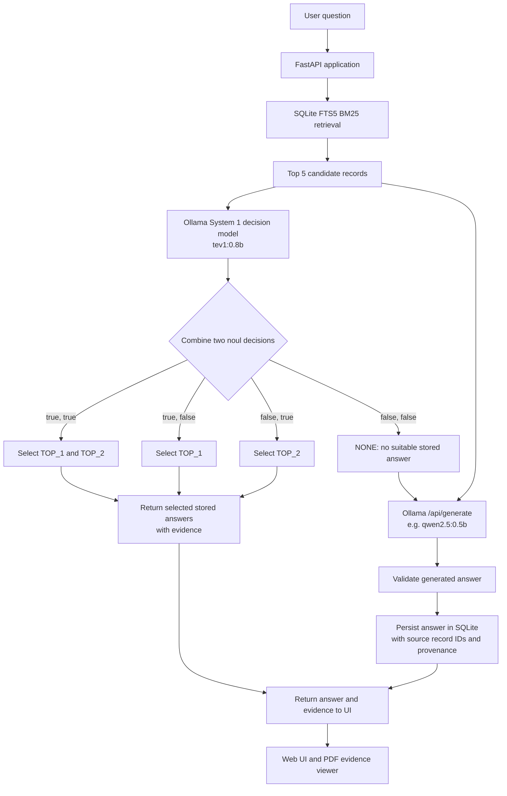

# ChoiceRAG

**ChoiceRAG** is a lightweight retrieval-augmented question-answering application built around **BM25**, **SQLite FTS5**, and an Ollama-hosted decision model. It retrieves relevant Q&A chunks from a corpus, selects the best answer candidates, and can synthesize a fallback answer from retrieved evidence when no existing answer is sufficient.

The application is designed to be practical and inspectable: retrieved answers retain evidence metadata so the UI can show source excerpts, page references, quote snippets, and PDF evidence in a side-by-side viewer.

## Features

- **BM25 retrieval:** Search a Q&A corpus using SQLite FTS5 full-text search.
- **Persistent local storage:** Keep corpus chunks and generated answers in SQLite.
- **System 1 answer selection:** Use an Ollama model (default `tev1:0.8b`) to decide whether the first candidate, second candidate, both, or neither are useful.
- **Fallback synthesis:** When the decision is `NONE`, optionally use a generation model such as `qwen2.5:0.5b` to synthesize an answer from the top five retrieved records.
- **Evidence-aware results:** Preserve evidence blocks, quotes, page numbers, bounding boxes, and source references when available.
- **PDF source viewer:** Open the source PDF and inspect the referenced page or evidence area.
- **Generated-answer persistence:** Store synthesized answers in the same database with provenance metadata so they can be retrieved later.
- **UI workflow visibility:** Show retrieval, decision, and generation stages, including timing information and whether generation was skipped.
- **FastAPI service:** Expose the application through an HTTP API.
- **Local model hosting:** Run inference through Ollama rather than requiring a hosted LLM API.

## Architecture



### High-level request lifecycle

1. The user submits a question in the web UI.
2. The API searches the corpus with SQLite FTS5/BM25 and returns the highest-ranked candidate records.
3. The System 1 decision model evaluates whether each of the first two candidates contributes distinct information.
4. The application maps the two boolean decisions to `TOP_1`, `TOP_2`, `BOTH`, or `NONE`.
5. If one or both stored answers are selected, the application returns those answers with their evidence metadata.
6. If the decision is `NONE`, the optional generation fallback sends the question and retrieved records to an Ollama generation endpoint.
7. The generated answer is stored with provenance metadata and returned to the UI. If generation cannot provide a supported answer, the application should return the configured fallback message.

## Answer-selection logic

The decision model answers two independent yes/no questions:

- `top1_adds_value`: Does candidate `TOP_1` provide relevant, supported information that adds something not already covered by `TOP_2`?
- `top2_adds_value`: Does candidate `TOP_2` provide relevant, supported information that adds something not already covered by `TOP_1`?

The application combines those values using this truth table:

| `top1_adds_value` | `top2_adds_value` | Selection | Meaning |
|---|---|---|---|
| `true` | `true` | `BOTH` | Both candidates add useful, distinct information. |
| `true` | `false` | `TOP_1` | Only the first candidate adds value. |
| `false` | `true` | `TOP_2` | Only the second candidate adds value. |
| `false` | `false` | `NONE` | Neither candidate adds sufficient value. |

When `NONE` is selected, the configured fallback message is:

```text
[No appropriate answer found, Ask an agent]
```

> **Note:** The model's boolean outputs are decisions, not guarantees of correctness. Evaluate the behavior against compound questions, duplicate answers, complementary facts, irrelevant candidates, and insufficient evidence.

## Generated-answer fallback

When the selection result is `NONE`, ChoiceRAG can call Ollama's generation API, for example:

```text
POST http://localhost:11434/api/generate
```

The request should include:

- The original user question.
- The top five retrieved database records.
- Instructions to answer only from those records.
- Instructions to combine complementary evidence where useful and not invent unsupported facts.

A representative request body is:

```json
{
  "model": "qwen2.5:0.5b",
  "stream": false,
  "options": {
    "temperature": 0.1,
    "num_predict": 300
  },
  "prompt": "Answer the user's question using only the supplied database records. Combine relevant facts, do not invent unsupported information, and state when the records are insufficient."
}
```

The actual application should construct the prompt dynamically from the question and retrieved records.

### Persisting synthesized answers

Generated answers can be stored in the **same SQLite database and corpus table** for easier retrieval. Keep provenance fields so the application can distinguish original corpus content from generated content.

Suggested metadata:

| Field | Purpose |
|---|---|
| `answer_source` | For example, `original` or `synthesized`. |
| `source_record_ids` | IDs of the records used to produce the answer. |
| `reviewed` | Whether a generated answer has been reviewed or approved. |
| `created_at` | When the answer was stored. |

Adapt these names to your actual schema. If FTS5 indexes the table, ensure new inserts and updates are reflected in the FTS index, using the existing triggers or index-maintenance logic.

**Recommended safeguards**

- Check for an existing equivalent question before inserting a new generated record.
- Do not save the configured no-answer fallback as a synthesized answer.
- Preserve source IDs and evidence for traceability.
- Treat generated records as unreviewed until checked if correctness is important.
- Consider excluding unreviewed generated records from retrieval, or ranking them separately, to reduce the risk of a generated answer being repeatedly retrieved as if it were authoritative.

## Evidence and PDF viewer

Where the corpus provides evidence metadata, each result can carry information such as:

- Source document or file identifier.
- Page number.
- Exact quote or excerpt.
- Evidence type, such as text or chart.
- Bounding box coordinates for highlighting a region on a PDF page.

The UI can use this metadata to open the source document at the relevant page and highlight the evidence. For synthesized answers, retain the IDs of the contributing records; a synthesized answer may combine evidence from multiple pages and should not be presented as one verbatim source quote.

The exact fields depend on the application's ingestion schema and the source document format.

## Technology stack

- **Python** — application and retrieval logic.
- **FastAPI** — HTTP API.
- **SQLite + FTS5** — persistent storage and full-text retrieval.
- **BM25** — ranking retrieved text.
- **Ollama System 1 model** — candidate answer decisions.
- **Ollama `/api/generate`** — optional synthesized-answer fallback.
- **Web UI** — search results, answer state, timing, and evidence display.
- **PDF viewer** — source inspection and evidence highlighting.

## Quickstart

These commands reflect the expected project layout; adjust file paths to match your checkout.

```bash
pip install -r requirements.txt
```

Place the source corpus in the `corpus/` directory, then ingest it:

```bash
python ingest.py corpus/corpus.md
```

Start the API:

```bash
uvicorn app.main:app --host 0.0.0.0 --port 8000 --reload
```

Open the UI at the configured frontend URL. If the UI is served by the same application, check the startup logs for its address.

### Ollama setup

Ensure Ollama is running and the required models are available:

```bash
ollama pull tev1:0.8b
ollama pull qwen2.5:0.5b
```

Check that Ollama is reachable:

```bash
curl http://localhost:11434/api/tags
```

On Windows Command Prompt, use `curl.exe` if `curl` is aliased to another command.

## Configuration

Configuration can be supplied through environment variables and, where supported by the UI, its settings bar.

| Variable | Purpose | Default |
|---|---|---|
| `OLLAMA_URL` | Base URL of the Ollama server. The decision client calls `/v1/systemone`; the generation client calls `/api/generate`. | `http://localhost:11434` |
| `OLLAMA_MODEL` | Model used for System 1 answer selection. | `tev1:0.8b` |
| `OLLAMA_TIMEOUT` | Request timeout in seconds for Ollama calls, subject to the application's client implementation. | `120.0` |
| Generation model | Model used for synthesized answers. Configure separately if supported by the application. | `qwen2.5:0.5b` |

If the API runs inside Docker, `localhost` inside the API container refers to that container, not the host. Configure `OLLAMA_URL` to a reachable Ollama service name or host address for your deployment.

## API health and diagnostics

The UI may show the number of retrieved records and timing for retrieval, decision, and generation. These timings help identify slow model calls.

If a health endpoint is implemented in the application, use the configured route (the screenshots show a `/health` link). For example:

```bash
curl http://localhost:8000/health
```

Confirm the route in your FastAPI app before relying on this command.

## Example behavior

### Stored answers are sufficient

**Question:** “What is the US 10-year yield expected 3-month range?”

If the decision model selects a relevant stored answer, ChoiceRAG returns the selected corpus answer and exposes its evidence. The generation stage is skipped.

### Both candidates are needed

If one candidate answers the forecast and another explains its implications, the result can be `BOTH` when both add distinct information. The UI can display both selected results and their source evidence.

### No stored answer is sufficient

If the result is `NONE`, the generation fallback can synthesize an answer from the top five retrieved records. The UI should identify it as synthesized and preserve provenance. If evidence is insufficient, return the configured no-answer message.

## Project layout

The commands above assume a layout similar to:

```text
ChoiceRAG/
├── app/
│   └── main.py
├── corpus/
│   └── corpus.md
├── ingest.py
├── requirements.txt
└── README.md
```

This is illustrative; retain the actual layout of your repository.

## Operational recommendations

- **Keep retrieval deterministic where possible:** tune FTS5 queries and BM25 ranking independently from model decisions.
- **Measure decision quality:** test the four decision outcomes on a labeled set of real questions.
- **Track latency:** log retrieval, decision, and generation times separately.
- **Protect provenance:** keep original source IDs and distinguish synthesized answers.
- **Prevent cache pollution:** deduplicate questions and decide whether unreviewed generated records may be used as retrieval candidates.
- **Handle failures gracefully:** timeouts, unavailable models, empty outputs, and malformed responses should return a controlled fallback rather than crash the request.
- **Be transparent in the UI:** distinguish stored source answers from synthesized answers and expose supporting evidence where available.

## License

Add the license used by your repository here.
